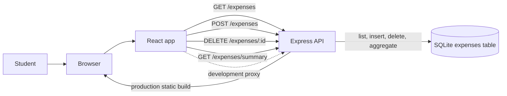

# Pocket Ledger

A small student expense tracker built with React, Express, and SQLite. Add everyday expenses, review totals by category, and keep the list across reloads.

## Run from a fresh checkout

Prerequisites: Node.js 22.12 or newer and npm. Node.js provides the built-in SQLite API.

```bash
npm ci
cp .env.example .env
npm run dev
```

On PowerShell, replace the copy command with `Copy-Item .env.example .env`. Open the URL configured by `VITE_PORT` (default: `http://localhost:5173`). The Express API uses `PORT` (default: `3000`). The first server start creates the SQLite file configured by `EXPENSES_DB_PATH` and its `expenses` table.

For a local production-style run, build the React app and then start Express:

```bash
npm run build
npm start
```

Open the URL configured by `PORT`. The `.env` file and database are local and ignored by Git; `.env.example` contains only non-secret settings for a fresh checkout.

## Using the app

Enter an expense name, amount, category, and date. The category choices are Food, Transportation, Shopping, and Other. The overview shows all-time spending and category totals. Each saved item can be deleted. A new database shows `No expenses yet.`

The React app uses these Express API routes:

- `GET /expenses` returns all expenses, newest date first.
- `POST /expenses` accepts JSON with `name`, `amount`, `category`, and `date`; it validates and saves the expense in SQLite.
- `DELETE /expenses/:id` permanently removes the matching row.
- `GET /expenses/summary` returns `{ "total": 0, "byCategory": { "Food": 0, "Transportation": 0, "Shopping": 0, "Other": 0 } }` for an empty database. The values are calculated from SQLite.

The `expenses` table has `id`, `name`, `amount`, `category`, and `date` columns. The API rejects invalid categories, non-positive amounts, missing names, and invalid dates.

## Architecture



## Live demo checklist

1. Start the app and add `Coffee`, amount `4.50`, category `Food`, and today's date.
2. Add `Bus fare`, amount `2.00`, category `Transportation`.
3. Confirm the total is `$6.50` and category totals show Food `$4.50` and Transportation `$2.00`.
4. Delete `Bus fare`; confirm the total returns to `$4.50` and Transportation returns to `$0.00`.
5. Refresh the browser and confirm `Coffee` remains while `Bus fare` stays deleted.

## Verify the database

From the project directory, inspect saved rows with Node.js:

```bash
node -e "require('dotenv').config(); const { DatabaseSync } = require('node:sqlite'); const db = new DatabaseSync(process.env.EXPENSES_DB_PATH); console.log(db.prepare('SELECT id, name, amount, category, date FROM expenses ORDER BY date DESC, id DESC').all()); db.close();"
```

The summary endpoint groups rows by category and separately sums every expense for the overall total. Login, bank connections, budgets, recurring expenses, charts, editing, and deployment are out of scope.